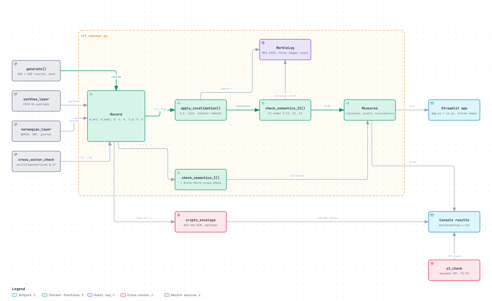

# TRF: Tri-Lateral Retention Feasibility Model

**Can one cross-border health audit record be kept, erased and deleted at once?** Executable artefact for the MSc thesis *Verifiable Crypto-Erasure for Cross-Border Health Data Audit Trails under the European Health Data Space* (Arshad Akhtar Abbasia, Høgskolen i Molde, 2026; supervisor Prof. João Ferreira).

[](https://doi.org/10.5281/zenodo.23819274)
[](https://github.com/Astheno-sphere/TRF/actions/workflows/tests.yml)
[](https://trfhimolde.streamlit.app/)
[](https://github.com/Astheno-sphere/TRF-thesis)
[](LICENSE)



| Obligation on the record | Source | Pulls toward |
|---|---|---|
| Retention floor | Art. 73(1)(e) EHDS (one year, SPE access logs); a period left to national law for the MyHealth@EU audit repository (six years in the Norwegian pilot) | keep it, verifiable |
| Right to erasure | Art. 17 GDPR | remove it |
| Deletion ceiling | Art. 68(12) EHDS (six months after the permit) | remove it by a deadline |

If *verifiable* means *readable*, the three cannot be met together whenever a deadline falls inside the retention window (Proposition 1). If it means *accountable* (who acted, when, a commitment, a logged invalidation entry), they can always be met (Proposition 2). This repository checks both on 200 synthetic records, with an exhaustive cross-check, a bounded Z3 check and real AES-256-GCM envelope encryption. Results are on synthetic data and are not estimates of real frequency; key destruction is attested, not proven; the retained residue is pseudonymised, not anonymous.

Python 3 (tested 3.11 to 3.13), standard library only for the checker and the Norwegian modules. No packages needed to reproduce the thesis result.

**Cite:** Abbasia, A. A. (2026). *TRF: Tri-Lateral Retention Feasibility Model. Executable artefact for EHDS and GDPR audit-log retention and erasure* [Computer software]. Zenodo. https://doi.org/10.5281/zenodo.23819274 (all versions; see `CITATION.cff`).

## Check everything at once

```bash
pip install -r requirements.txt pytest
python3 -m pytest -q tests/
```

56 checks: every recorded run in `docs/` reproduces byte for byte, every page of the app renders, the app's claim ledger matches all 27 Chapter 5 figures, the exhaustive cross-check agrees with the checker at every boundary month, and (when the thesis repository sits beside this one) every proposition the app quotes is verbatim from Chapter 4. The same tests run on every push.

## Reproduce the thesis result

```bash
python3 trf_checker.py
```

Expected output, which must match `docs/expected_trf_output.txt` byte for byte:

| Measure | Value |
|---|---|
| Semantics I, records with at least one violation | 90 / 200 |
| Semantics I, total violations | 95 |
| Corollary 1.2 witnesses, no erasure request | 39 |
| Records invalidated | 138 (52 under GDPR Art 17(1), 86 under EHDS Art 68(12)) |
| Semantics II, total violations | 0 |
| Reference commitment, record 100 | `678ade47c1e6dc03…` |

Seed 20260915 is fixed in the module header. If a number differs, the file has changed.

Extended erasure response period, Chapter 5 §5.6:

```bash
python3 trf_checker.py --delta-witness
```

Reproduces Table 5.5: 90 records and 95 violations at δ = 1, against 89 and 94 at δ = 3, with 39 Corollary 1.2 witnesses and zero Semantics II violations at both. The infeasibility is structural, not a consequence of the one-month response period.

Every recorded run lives in `docs/`, one file per command, for diffing:

| Command | Recorded output |
|---|---|
| `python3 trf_checker.py` | `docs/expected_trf_output.txt` |
| `python3 trf_checker.py --delta-witness` | `docs/expected_delta_witness_output.txt` |
| `python3 synthea_layer.py` | `docs/expected_synthea_subset_output.txt` |
| `python3 norwegian_layer.py` | `docs/expected_norwegian_output.txt` |
| `python3 cross_sector_check.py` | `docs/expected_cross_sector_output.txt` |

## Payload independence

```bash
python3 synthea_layer.py
```

It reads `synthea_run/output/fhir/` if you have regenerated the full cohort, and otherwise falls back to the eight bundles in `data/synthea_subset/`.

Every reported figure is identical to the constructed-payload run while all 200 commitments differ. Mean payload rises from 43 bytes to 891 with this 8-bundle subset, and to 1,002 with the full 98-bundle cohort (that run was recorded on 28 September, before the constructed payloads were revised, and shows 35 bytes on the constructed side). The model reads timing and accessibility, never payload content.

## Norwegian context modules

Parallel to the thesis result. They import `trf_checker.py` unmodified and change nothing it reports.

```bash
python3 norwegian_layer.py       # NO-XB, NO-SPE, NO-JOURNAL classes with case walkthroughs
python3 cross_sector_check.py    # politiregisterloven § 17: floor 12 months, ceiling 36
```

The same two modules drive the Norwegian context page of the app. See `norwegian_docs/NORWEGIAN_MODULE_README.md` for what is varied, what is not, and the limits, and `norwegian_docs/HOW_TO_RUN.md` for a step-by-step guide and a demonstration script.

All Python files sit at the repository root, because Streamlit Cloud runs `app.py` from there and imports its neighbours.

## Contents

| Path | What it is | Lines |
|---|---|---|
| `trf_checker.py` | Feasibility checker: executable witness for Propositions 1 and 2, with an exhaustive cross-check compared against it and an audit-log integrity check (Merkle log, tamper test) | 601 |
| `synthea_layer.py` | Realism layer and payload-provenance comparison | 156 |
| `app.py`, `ui.py` | Streamlit viewer over the artefact, never a source of results. Eleven pages: Start here (the walk through the thesis, with Previous/Next along it), Witness a record (one record's months, with the acting components of the mechanism lit on Figure 4.1), The four propositions (statements verbatim from Chapter 4, their stated limits, live evidence and a live Z3 run), How it is built (both Archify diagrams, interactive), Thesis run, Claim ledger (every Chapter 5 figure beside its live recomputation), Where the ceiling is anchored (Proposition 3), Robustness and cross-checks, Synthea realism, Norwegian context, Explore. `ui.py` is presentation only | 1124 + 217 |
| `norwegian_layer.py` | Three Norwegian record classes | 136 |
| `cross_sector_check.py` | Cross-sector instance from Norwegian police register law | 113 |
| `crypto_envelope.py` | Optional: the same record lifecycle with AES-256-GCM envelope encryption; shows that exactly the invalidated records refuse to decrypt through custody (destruction attested, not proven). Needs `cryptography`; reports no thesis figure | 122 |
| `z3_check.py` | Optional: bounded SMT check of Propositions 1–3 with the Z3 solver; every parameter combination within stated bounds (floor up to 120 months), with mutation checks that must fail. Needs `z3-solver` (`pip install z3-solver`); recorded run in `docs/expected_z3_check_output.txt` | 160 |
| `data/synthea_subset/` | 8 untrimmed Synthea FHIR R4 bundles, seed 20260915 | 8 files |
| `docs/Appendix_A.md` | Appendix A: provenance, commands, full source listings, console output | — |
| `docs/expected_trf_output.txt` | The recorded checker run, to diff against | — |
| `docs/expected_delta_witness_output.txt` | Recorded δ = 1 against δ = 3 run, Chapter 5 §5.6 | — |
| `docs/expected_synthea_subset_output.txt` | Recorded realism-layer run against the committed subset | — |
| `docs/expected_norwegian_output.txt` | Recorded Norwegian-layer run | — |
| `docs/expected_cross_sector_output.txt` | Recorded politiregisterloven § 17 run | — |
| `docs/Data_Provenance_Statement.md` | Where the synthetic data came from, and how to check it yourself | — |

## Regenerating the full cohort

```bash
java -jar synthea.jar -s 20260915 -cs 20260915 -p 100 \
  --exporter.fhir.export=true --exporter.hospital.fhir.export=false \
  --exporter.practitioner.fhir.export=false --generate.only_alive_patients=true
```

Yields 98 usable bundles from 100 requested. Synthea's default export is US Core with United States demographics, not Norwegian basisprofiler. The FHIR version, R4, matches the version the Norwegian profiles constrain. No claim of Norwegian clinical representativeness is made, and the payload-independence result is why that does not affect any figure.

## Robustness

The Thesis run page also shows the audit-log integrity check and all three tamper tests (Chapter 5 §5.7). Robustness and cross-checks runs the checks the thesis reports and the other pages do not show, and the optional envelope-encryption module. Where the ceiling is anchored evaluates the condition of Proposition 3 for any floor and ceiling.

Architecture diagrams (Figures 4.1 and 5.1) were drawn with [Archify](https://github.com/tt-a1i/archify); their source JSON is in `docs/architecture/`, the rendered HTML and PNG in `assets/`.

The **exhaustive cross-check** enumerates all 2¹⁴ assignments of the accessibility variable over a fourteen-month horizon using `brute_force_semantics_I()`, a separate function from `check_semantics_I()` that shares only the constants `DELTA` and `CEILING`. `tests/test_props.py` compares the two on 31 cases, including every boundary month of a twelve-month window, so a boundary error in either shows up as a disagreement; the checker itself also compares them on its four cases and exits non-zero on a mismatch. The control case, where neither the erasure right nor the ceiling is active, returns feasible, so the search can succeed when it should.

The **δ witness** re-runs the population at δ = 1 and δ = 3, the extension Article 12(3) GDPR allows for complex requests, and shows the infeasibility surviving the longer period.

## What this artefact does not do

It does not connect to any National Contact Point, implement the OpenNCP transmission flow, evaluate consent policies, or implement any zero-knowledge proof system. Key destruction is simulated by removing a reference in program state: it demonstrates the mechanism's logic and says nothing about whether destruction can be assured in deployment.

## Data

All data is synthetic, generated by Synthea. No real patient data was requested, obtained or processed at any point.

## Licence

MIT (`LICENSE`). The synthetic data are Synthea output; provenance in `data/synthea_subset/README.md`.

## Changes

Every change to the code is logged in [`CHANGE_TRAIL.md`](CHANGE_TRAIL.md), with the tests that gate it. Releases are archived on Zenodo; the concept DOI above always resolves to the latest version.
